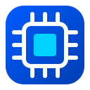

<div align="center">
  
  <h1>Ozon PC Configurator</h1>
  <p><strong>Полноэкранный конфигуратор сборки ПК из комплектующих на Ozon с проверкой совместимости, расчётом TDP и отправкой всей сборки в корзину в один клик.</strong></p>
  <p>Автор проекта: <strong>Nikita Emelyanov</strong></p>

  <p>
    
    
    
    
  </p>
</div>

---

## ✨ Основные возможности

- **Полноэкранный интерфейс в стиле DNS Конфигуратора:**
  - **8 обязательных категорий:** Процессор, Материнская плата, Видеокарта, Оперативная память, Охлаждение процессора, Накопители (SSD/HDD), Блок питания, Корпус.
  - **7 дополнительных категорий и периферии:** Вентиляторы и термопаста, Звуковая карта, Монитор, Клавиатура, Мышь, Гарнитура и акустика, ПО.
- **Умный движок совместимости в реальном времени:**
  - Проверка сокетов процессора, материнской платы и кулера (`AM4`, `AM5`, `LGA1700`, `LGA1851`, `LGA1200`, `LGA2011-3`).
  - Проверка поколения памяти (`DDR4`/`DDR5`) и подсчёт занятых слотов ОЗУ (`2xDDR4`, `4xDDR5`, двухканальный режим).
  - Проверка совместимости форм-фактора материнской платы (`ATX`, `Micro-ATX`, `Mini-ITX`, `E-ATX`) и корпуса.
  - Расчёт суммарного энергопотребления (TDP) и рекомендации мощности блока питания с запасом.
- **Живой каталог Ozon внутри модального окна:**
  - Многостраничная подгрузка товаров с прогресс-баром, фасетными фильтрами (сокет, память, форм-фактор, объём, интерфейс), сортировкой по цене/рейтингу/отзывам и ценами **с Ozon Картой** и без неё.
- **Полный технический паспорт товара под спойлером (`Характеристики ▸`):**
  - Раскрытие полных характеристик каждого выбранного компонента прямо внутри слота.
- **Добавление со страниц товаров Ozon:**
  - Кнопка **`+ В конфигуратор ПК`** на карточках товаров `ozon.ru/product/...` с автоопределением категории и мгновенной синхронизацией вкладки конфигуратора.
- **Корзина, сравнение и обмен сборками:**
  - **Добавить всё в корзину Ozon** в один клик (с учётом количества штук каждого компонента).
  - **Поделиться/Импорт:** генерация компактного кода сборки `OZPC1:...` и экспорт/импорт в `.json`.
  - **Библиотека и сравнение сборок:** сохранение нескольких конфигураций и наглядное сравнение двух сборок по цене, TDP и комплектующим.
---

## 🚀 Установка расширения

### Zen Browser/Mozilla Firefox (≥ 115)
1. Скачайте или клонируйте репозиторий:
   ```bash
   git clone https://github.com/<ВАШ_НИК>/ozon-pc-configurator.git
   ```
2. Откройте в браузере страницу **`about:debugging#/runtime/this-firefox`**.
3. Нажмите **«Загрузить временное дополнение…»** (`Load Temporary Add-on…`).
4. Выберите файл **`manifest.json`** из корневой папки проекта.
5. Нажмите на иконку **Ozon PC Configurator** на панели расширений — откроется полноэкранная вкладка конфигуратора.

### Google Chrome/Яндекс Браузер/Edge/Brave
1. Откройте **`chrome://extensions/`** и включите **«Режим разработчика»** (`Developer mode`).
2. Нажмите **«Загрузить распакованное расширение»** (`Load unpacked`).
3. Выберите корневую папку проекта **`ozon-pc-builder-extension`**.

---

## 🗂 Архитектура проекта

```text
ozon-pc-builder-extension/
├── manifest.json                  # Конфигурация Manifest V3 (Firefox/Zen/Chromium)
├── assets/
│   └── icons/
│       └── icon.svg               # Векторная иконка расширения
└── src/
    ├── background/
    │   └── service-worker.js      # Управление вкладками, проксирование Ozon API и корзины
    ├── shared/
    │   ├── constants.js           # Категории комплектующих, URL и настройки сортировки
    │   ├── ozon-api.js            # Многостраничный парсер каталога и характеристик Ozon
    │   ├── compatibility.js       # Парсинг характеристик, фасеты и движок совместимости
    │   ├── storage.js             # Хранение текущей сборки и библиотеки сборок
    │   └── share-codec.js         # Кодирование/декодирование сборок в код OZPC1 и JSON
    ├── builder/
    │   ├── builder.html           # Разметка полноэкранного конфигуратора и модальных окон
    │   ├── builder.css            # Адаптивные стили интерфейса
    │   ├── builder.js             # Точка входа, события, библиотека и обмен сборками
    │   ├── builder-state.js       # Состояние приложения и хелперы DOM
    │   ├── builder-slots.js       # Рендер слотов, сводной панели и спойлеров характеристик
    │   ├── builder-picker.js      # Логика модального окна подбора и фильтрации товаров
    │   ├── builder-compare.js     # Таблица сравнения двух сборок
    │   └── slot-icons.js          # Набор векторных SVG-иконок категорий
    └── content/
        └── product-injector.js    # Кнопка «+ В конфигуратор ПК» на страницах товаров Ozon
```

---

## 📸 Скриншоты

> *(Вы можете добавить сюда скриншоты главного экрана, модального окна подбора и сравнения сборок в папку `docs/screenshots/`)*

---

## 📄 Лицензия

Copyright © 2026 **Nikita Emelyanov**.  
Проект распространяется под лицензией **MIT**. Подробнее см. в файле [LICENSE](LICENSE).

---

> *Примечание: при проектировании архитектуры, написании модульных тестов и оформлении документации использовались ИИ-ассистенты.*
